# Trabajo práctico N° 4: Medición de la calidad del sistema

## Portada

| | |
| --- | --- |
| **Alumno** | *[Nombre y apellido]* |
| **Tesis** | Plataforma de Gestión de Deudas (Expense Manager) |
| **Tecnologías** | Web: React 19, Vite (rolldown-vite), Tailwind CSS 4, zustand, axios, Firebase Auth, Pusher. API: Node.js 22, Express 5, PostgreSQL (Supabase), JWT. App móvil: Flutter. |
| **Repositorios** | https://github.com/Gonn01/web-plataformas-de-desarrollo · https://github.com/Gonn01/api-plataformas-desarrollo |
| **URL de producción** | https://web-plataformas-de-desarrollo.vercel.app |

## 1. Objeto de estudio

Sistema de gestión de finanzas personales compuesto por una **aplicación web (SPA en React)**, una **app móvil en Flutter** y una **API REST en Node/Express** que comparten las dos. Permite registrar deudas y gastos (en cuotas, fijos o de pago único) por entidad, compartirlos con otros usuarios y hacer las cuentas del mes en varias monedas. Sus usuarios son **personas que administran sus propias deudas y gastos**, y las personas con las que los comparten (familia, amigos, pareja).

## 2. Dimensiones de calidad elegidas

El sistema mezcla dos tipos de proyecto de la guía: una web pública que es la puerta de entrada (login y registro), y una API que maneja dinero y credenciales. Por eso elegí tres dimensiones, una por cada riesgo principal:

| Dimensión | Por qué es relevante para el proyecto | RNF relacionado |
| --- | --- | --- |
| **Calidad del código (análisis estático)** | La API concentra las reglas de negocio de los dos clientes, y el módulo de Pagos y Hacer cuentas (el crítico de los TP 2 y 3) vive en services largos. El código difícil de entender es justo el que registra dinero. | RNF-MAN-01 (lógica de negocio solo en los services), RNF-MAN-05 (el código pasa el linter) |
| **Seguridad (dependencias)** | El sistema maneja sesiones con JWT, datos financieros personales y contraseñas. Una vulnerabilidad en una dependencia del camino de autenticación compromete a todos los usuarios. | RNF-SEG-02 (sesión con JWT firmado), RNF-SEG-03 (rutas protegidas por token), RNF-SEG-11 (no exponer la tecnología del servidor) |
| **Rendimiento web, accesibilidad y SEO (front-end)** | El login es la primera pantalla que ve cualquier usuario, casi siempre desde el celular. Si tarda en cargar, el usuario abandona antes de entrar. La accesibilidad está comprometida en el sistema para todas las pantallas. | RNF-REN-06 (carga de pantallas bajo demanda), RNF-USA-09 (contraste en los dos temas), RNF-DIS-04 (la web funciona sin el servicio de tiempo real) |

## 3. Herramientas y ejecución

| Dimensión | Herramienta | Qué mide | Cómo se ejecutó |
| --- | --- | --- | --- |
| Calidad del código | **ESLint 9.39.5 + eslint-plugin-sonarjs 4.2.2** | Bugs, *code smells*, complejidad cognitiva y *security hotspots*, con las mismas reglas que usa el analizador de JavaScript de SonarQube. | Por consola, con una configuración aparte que activa las reglas recomendadas de SonarJS sobre todo el repositorio (sin las pruebas): `npx eslint --no-config-lookup -c sonar.config.mjs . -f html -o reporte.html`. |
| Seguridad | **npm audit** (npm 11.2.0) | Vulnerabilidades conocidas en las dependencias directas y transitivas, por severidad, con la versión que las corrige. | Por consola en cada repositorio: `npm audit --json` (todas las dependencias) y `npm audit --omit=dev --json` (solo las que llegan a producción). |
| Rendimiento web, accesibilidad y SEO | **Lighthouse 12.8.2** (Chrome 158) | Puntajes de rendimiento, accesibilidad, buenas prácticas y SEO, Core Web Vitals (FCP, LCP, CLS, TBT) y oportunidades de mejora. | Por consola con la CLI, en **modo mobile** (emulación de Moto G Power con 4G lento simulado), **Chrome headless en incógnito** y sin extensiones: `npx lighthouse http://localhost:4173/login --chrome-flags="--headless=new --incognito"`. Se midió el *build* de producción servido con `vite preview`, para poder comparar el antes y el después en las mismas condiciones. Se midieron `/login` y `/register`, las únicas páginas sin sesión. |

> **Condición de medición.** El `.env` local no tiene la clave de Pusher (`VITE_PUSHER_KEY`), y sin ella la web queda en blanco (hallazgo H-06). Para medir la interfaz real, el *build* se generó con una clave de relleno, igual en el antes y en el después.

## 4. Resultados por herramienta

### 4.1. ESLint + SonarJS (calidad del código)

| Repositorio | Archivos | Problemas (antes) |
| --- | --- | --- |
| API | 62 | **12**: 6 `pseudo-random`, 4 `cognitive-complexity`, 1 `no-identical-functions`, 1 `x-powered-by` |
| Web | 158 | **38**: 28 `no-nested-conditional`, 4 `cognitive-complexity` y 6 de otras reglas |

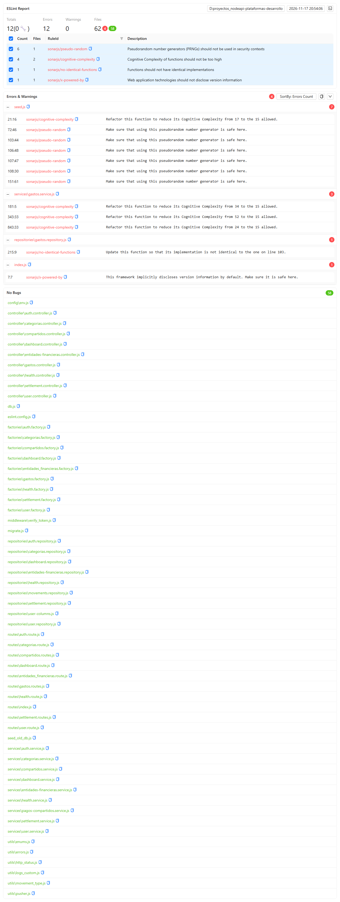

*Figura 1: reporte de ESLint + SonarJS sobre la API (`D:/proyectos_node/api-plataformas-desarrollo`), antes de corregir. 12 problemas en 4 archivos.*

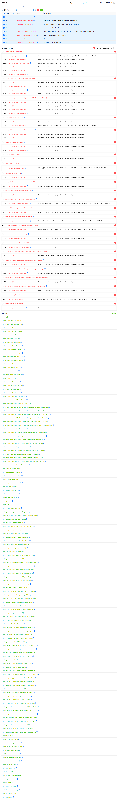

*Figura 2: reporte de ESLint + SonarJS sobre la web (`src/`), antes de corregir. 38 problemas.*

#### Tabla de hallazgos: ESLint + SonarJS

| ID | Herramienta | Dimensión | Hallazgo | Dónde se detectó | Impacto | Severidad | Mejora propuesta | ¿Corregido? |
| --- | --- | --- | --- | --- | --- | --- | --- | --- |
| H-08 | ESLint + SonarJS | Código | Complejidad cognitiva de **52** (máximo 15) en la edición de gastos, **34** en la normalización de sus campos y **24** en el pago en lote del cierre de la sesión de cuentas | API, `services/gastos.service.js`: `update()` (línea 342), `#normalizarUpdate()` (181) y `effectSettlementBatch()` (843) | Usuario: un error en esas funciones registra mal un pago o una edición. Mantenimiento: es el código más difícil de probar y modificar del sistema, y está en el módulo crítico | Alta | Extraer un `PagosService` y separar la validación de cada campo en funciones chicas (plan preventivo del TP 3) | No: queda planificado |
| H-09 | ESLint + SonarJS | Código | Función idéntica a otra: `GastosRepository.settleQuota()` repetía el mismo `SELECT` que `getById()`, y ningún service la usaba | API, `repositories/gastos.repository.js`, línea 215 | Usuario: ninguno directo. Mantenimiento: código muerto con un nombre engañoso (no paga ninguna cuota); alguien podría usarlo creyendo que registra un pago | Media | Eliminarla | **Sí** |
| H-10 | ESLint + SonarJS | Código / seguridad | *Security hotspot*: Express envía el encabezado `X-Powered-By: Express`, que le dice a un atacante con qué tecnología está hecho el servidor | API, `index.js`, línea 7 | Usuario: ninguno directo. Facilita buscar vulnerabilidades específicas de Express | Media | `app.disable("x-powered-by")` | **Sí** |
| H-11 | ESLint + SonarJS | Código | Complejidad cognitiva de **51** en la tarjeta de gasto y de **29** en el armado del resumen de WhatsApp | Web, `src/components/ExpenseCard.jsx` (línea 12) y `src/utils/build-whats-app-text.js` (línea 31) | Mantenimiento: componente muy usado (dashboard y detalle de entidad) y difícil de cambiar sin romper algún caso | Media | Separar en subcomponentes y funciones de formato | No |
| H-12 | ESLint + SonarJS | Código | Tres errores menores de lógica: un ternario con las dos ramas iguales (`sub ? 'text-lg' : 'text-lg'`), una asignación redundante en un `switch`, y una función llamada con un argumento que no usa (`formatAxis(v, moneda)`, que ignora la moneda) | Web, `StatCards.jsx:82`, `GastoItem.jsx:21`, `MontoChart.jsx:145` | Mantenimiento: el código sugiere algo que no hace (que el eje del gráfico se formatea según la moneda) | Baja | Simplificar | **Sí** |
| H-13 | ESLint + SonarJS | Código | Expresión regular con tiempo super-lineal (*backtracking*) | Web, `src/utils/amount-input.js`, línea 17 | Usuario: en teoría puede trabar el campo de monto con una entrada muy larga; en la práctica, el texto de un monto es corto | Baja | Reescribir la expresión sin cuantificadores anidados | No |
| H-14 | ESLint + SonarJS | Código | 28 ternarios anidados en 17 archivos | Web, por ejemplo `ExpenseCard.jsx`, `TabHeader.jsx` y `ConfirmPaymentModal.jsx` (4 cada uno) | Mantenimiento: código difícil de leer | Baja | Reemplazar por funciones con `if` o mapas de valores | No |
| H-15 | ESLint + SonarJS | Código | 6 usos de `Math.random()` señalados como inseguros | API, `seed.js` | Ninguno: es el script que genera datos de prueba, no se usa para seguridad. **Falso positivo** | Baja | Ninguna | No aplica |

### 4.2. npm audit (seguridad)

| Repositorio | Todas las dependencias (antes) | Solo producción (antes) |
| --- | --- | --- |
| API | **25** (4 críticas, 13 altas, 8 moderadas) | **7** (1 crítica, 5 altas, 1 moderada) |
| Web | **18** altas | **12** altas |

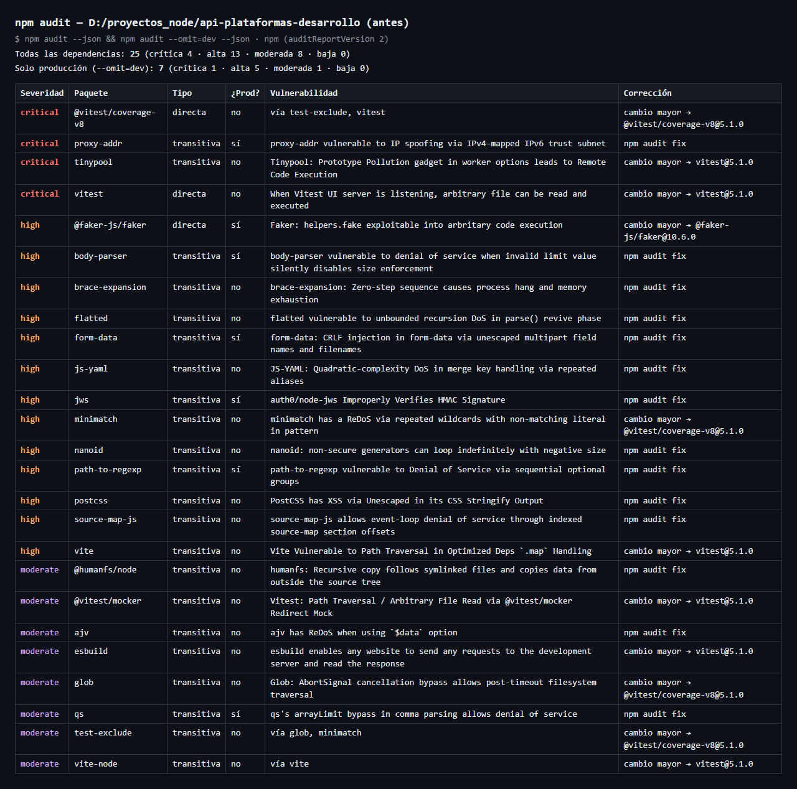

*Figura 3: resultado de `npm audit` en la API, antes de corregir. La columna "¿Prod?" indica si el paquete llega a producción.*

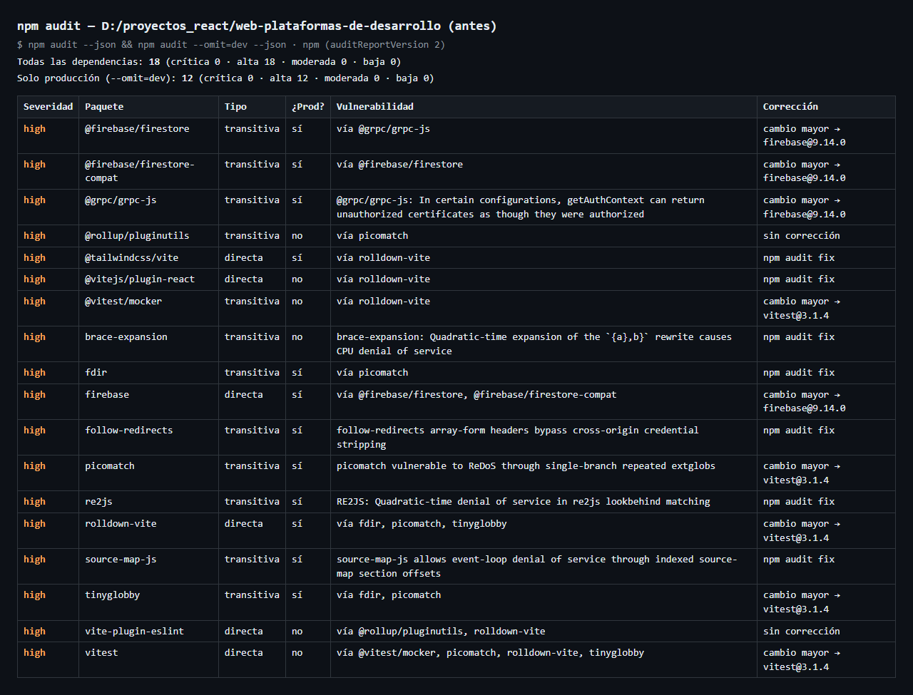

*Figura 4: resultado de `npm audit` en la web, antes de corregir.*

#### Tabla de hallazgos: npm audit

| ID | Herramienta | Dimensión | Hallazgo | Dónde se detectó | Impacto | Severidad | Mejora propuesta | ¿Corregido? |
| --- | --- | --- | --- | --- | --- | --- | --- | --- |
| H-16 | npm audit | Seguridad | `jws` verifica mal la firma HMAC. Es la librería que usa `jsonwebtoken` para validar el token de sesión | API, dependencia transitiva de `jsonwebtoken` (producción) | Usuario: en el peor caso, un token mal firmado podría aceptarse como válido y dar acceso a los datos de otra persona | **Alta** | `npm audit fix` | **Sí** |
| H-17 | npm audit | Seguridad | Express arrastraba versiones vulnerables de `proxy-addr` (crítica: suplantación de IP), `body-parser` y `path-to-regexp` (altas: denegación de servicio) y `qs` (moderada) | API, dependencias transitivas de `express` (producción) | Usuario: una petición armada podría dejar la API sin responder para todos | **Alta** | `npm audit fix` | **Sí** |
| H-18 | npm audit | Seguridad | `@faker-js/faker` estaba en `dependencies`, así que se instalaba en producción, con una vulnerabilidad alta (ejecución de código en `helpers.fake`). Solo lo usa `seed.js` | API, `package.json` | Usuario: ninguno directo, porque la API no lo llama. Mantenimiento: amplía la superficie de ataque sin necesidad | Media | Moverlo a `devDependencies` | **Sí** (sigue en desarrollo; corregirlo del todo exige pasar a faker 10) |
| H-19 | npm audit | Seguridad | Vitest 2.1.9 y su cadena (`tinypool`, `vite`, `esbuild`) con 4 vulnerabilidades críticas, entre ellas ejecución remota de código y lectura de archivos | API, `devDependencies` | Solo en la máquina de desarrollo y en CI, no en producción | Media | Actualizar a Vitest 5.1, la misma versión que la web | **Sí**: las 252 pruebas siguen pasando |
| H-20 | npm audit | Seguridad | `follow-redirects` (usada por axios) no borra los encabezados de credenciales al seguir una redirección a otro dominio | Web, dependencia transitiva de `axios` (producción) | Usuario: si la API respondiera con una redirección a otro dominio, el token de sesión (`Authorization`) podría filtrarse | **Alta** | `npm update follow-redirects axios` | **Sí** |
| H-21 | npm audit | Seguridad | `firebase` incluye `@firebase/firestore` → `@grpc/grpc-js`, que puede aceptar certificados no autorizados. La web solo usa Firebase **Auth**, no Firestore | Web, dependencia directa `firebase@12` (producción) | Usuario: bajo, porque la web no usa Firestore. Pero el paquete vulnerable está en el árbol | Media | Pasar a `firebase@13` y verificar el inicio de sesión con Google | No: es un cambio de versión mayor |
| H-22 | npm audit | Seguridad | Herramientas de *build* vulnerables (`rolldown-vite`, `picomatch`, `vite-plugin-eslint`). `vite-plugin-eslint` no tiene corrección y está abandonado | Web, `package.json` | Solo en desarrollo y en el *build*, no llegan al navegador | Baja | Reemplazar `vite-plugin-eslint` por la ejecución de ESLint en CI | No |

### 4.3. Lighthouse (rendimiento, accesibilidad y SEO)

| Página (mobile) | Rendimiento | Accesibilidad | Buenas prácticas | SEO | FCP / LCP | Peso total |
| --- | --- | --- | --- | --- | --- | --- |
| `/login` (antes) | **68** | 100 | 100 | **82** | 5,2 s / 5,2 s | 810 KiB |
| `/register` (antes) | **68** | 100 | 100 | **82** | 5,2 s / 5,2 s | 810 KiB |

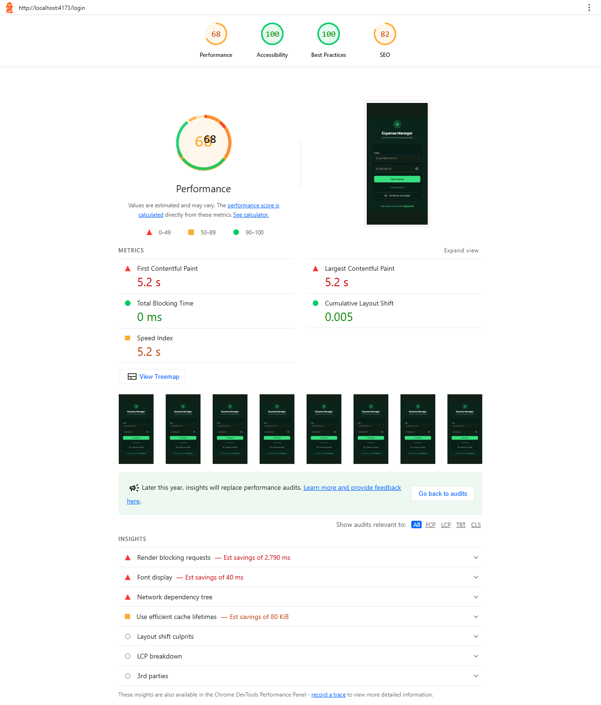

*Figura 5: Lighthouse mobile en `http://localhost:4173/login`, antes de optimizar. Puntajes y métricas principales.*

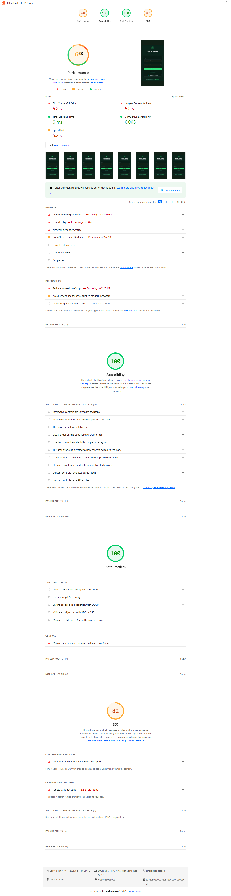

*Figura 6: Lighthouse mobile en `/login`, antes de optimizar. Reporte completo con los problemas detectados.*

#### Tabla de hallazgos: Lighthouse

| ID | Herramienta | Dimensión | Hallazgo | Dónde se detectó | Impacto | Severidad | Mejora propuesta | ¿Corregido? |
| --- | --- | --- | --- | --- | --- | --- | --- | --- |
| H-01 | Lighthouse | Rendimiento | Toda la aplicación se descarga en un único archivo JavaScript de 1164 KB (325 KB comprimido). En el login, **229 KiB no se usan**: el dashboard, los gráficos y el resto de las pantallas privadas | `/login` y `/register`, `dist/assets/index-*.js`. Causa: `src/App.jsx` importa todas las pantallas de forma estática | Usuario: LCP de **5,2 s** en mobile antes de poder iniciar sesión | **Alta** | Cargar cada pantalla de `/app` con `React.lazy()` | **Sí**: JS sin usar 229 → 75 KiB, LCP 5,2 → 4,2 s |
| H-02 | Lighthouse | SEO | `robots.txt` inválido (**32 errores**): no existe, y la regla de Vercel que redirige todo a `index.html` hace que el buscador reciba el HTML de la app | `/robots.txt`, por la regla de `vercel.json` | Usuario: ninguno directo. Los buscadores no saben qué pueden indexar y podrían intentar rastrear las rutas privadas | Media | Agregar `public/robots.txt` que permite `/login` y `/register` y excluye `/app/` | **Sí** |
| H-03 | Lighthouse | SEO / accesibilidad | El documento no tiene *meta description*, su título es el nombre del repositorio (`web-plataformas-de-desarrollo`) y declara `lang="en"` en un sitio escrito en español. Además, cada fuente de Google se cargaba **dos veces** | `index.html` | Usuario: en un buscador aparece sin descripción y con un título técnico. Un lector de pantalla lee el texto en español con pronunciación en inglés | Media | Título y descripción reales, `lang="es"` y una sola carga por fuente | **Sí**: SEO 82 → 100 |
| H-04 | Lighthouse | Rendimiento / recursos | La fuente de íconos Material Symbols pesa **317 KiB**, más que todo el JavaScript de la página. Además, la versión que se carga no tiene el eje `FILL`, así que la propiedad `filled` del componente `Icon` no cambia nada | `index.html` (fuente de Google Fonts) y `src/components/Icon.jsx` | Usuario: más datos móviles y más espera en la primera carga. Los íconos "rellenos" se ven igual que los de contorno | Media | Pedir solo los íconos usados con el parámetro `icon_names` de Google Fonts, o reemplazarlos por SVG | No: pedir el rango de `FILL` aumentó la fuente a 465 KB, así que hace falta el subconjunto por nombre |
| H-05 | Lighthouse | Rendimiento | El CSS de Google Fonts bloquea el primer dibujo de la página (ahorro estimado de **2790 ms**) | `index.html`: hojas de estilo de Manrope y Material Symbols | Usuario: la pantalla queda en blanco mientras se descargan las fuentes | Media | Alojar las fuentes en el propio sitio con `preload`, o cargarlas sin bloquear | Parcial: quitar las cargas duplicadas bajó el estimado a 2650 ms |
| H-06 | Lighthouse | Disponibilidad | Error de ejecución `NO_FCP`: **la página no dibuja nada**. Sin la variable `VITE_PUSHER_KEY`, el cliente de Pusher lanza una excepción al cargarse y la aplicación entera queda en blanco, incluido el login | `src/lib/pusher.js` (crea el cliente al importarse) | Usuario: en cualquier entorno sin esa variable (local, *preview*) no se puede ni iniciar sesión. Incumple RNF-DIS-04 (la web tiene que seguir funcionando sin el servicio de tiempo real) | **Alta** | Crear el cliente de Pusher solo si la clave está configurada y que `use-pusher-channel` lo tolere ausente | No: queda registrado como limitación conocida de RNF-DIS-04 |
| H-07 | Lighthouse | Rendimiento | *(detectado en el después)* 15 KiB de JavaScript sin minificar en el *chunk* principal, y `iframe.js` de Firebase Auth (93 KiB) con una política de caché corta, que es de un tercero | `dist/assets/index-*.js` y `purchase-app-tp.firebaseapp.com/__/auth/iframe.js` | Usuario: unos KB más en la primera carga | Baja | Revisar qué dependencia llega sin minificar; el de Firebase no depende del proyecto | No |

**Accesibilidad y buenas prácticas** dieron **100** en las dos páginas: los campos tienen `label`, el contraste alcanza en los dos temas y no hay errores de consola.

## 5. Mejoras aplicadas y re-medición

Se corrigieron **12 de los 22 hallazgos** (H-01, H-02, H-03, H-05 en parte, H-09, H-10, H-12, H-16, H-17, H-18, H-19 y H-20). Después se volvieron a ejecutar las tres herramientas en las mismas condiciones.

### 5.1. Rendimiento y SEO: carga por pantalla, `robots.txt` y metadatos (H-01, H-02, H-03)

- **`src/App.jsx`:** las pantallas de `/app` (y `AppLayout`) pasaron a cargarse con `lazy()`. Login y registro siguen importándose directo.
- **`src/layouts/AppLayout.jsx`:** un `Suspense` alrededor del `Outlet`, para que la barra lateral no desaparezca mientras carga una pantalla.
- **`public/robots.txt`:** archivo nuevo.
- **`index.html`:** `lang="es"`, título y descripción reales, y una sola carga por fuente.

| Métrica (`/login`, mobile) | Antes | Después |
| --- | --- | --- |
| Rendimiento | 68 | **76** |
| SEO | 82 | **100** |
| First Contentful Paint | 5,2 s | **4,2 s** |
| Largest Contentful Paint | 5,2 s | **4,2 s** |
| Peso total de la página | 810 KiB | **539 KiB** |
| JavaScript sin usar | 229 KiB | **75 KiB** |
| *Bundle* principal | 1164 KB (325 KB comprimido) | **488 KB (143 KB comprimido)** |
| Errores de `robots.txt` | 32 | **0** |

En `/register` el rendimiento también pasó de 68 a 76 y el SEO de 82 a 100 (LCP 5,2 → 4,1 s).

*Figura 7: Lighthouse mobile en `/login`, **antes**. Rendimiento 68, SEO 82, LCP 5,2 s.*

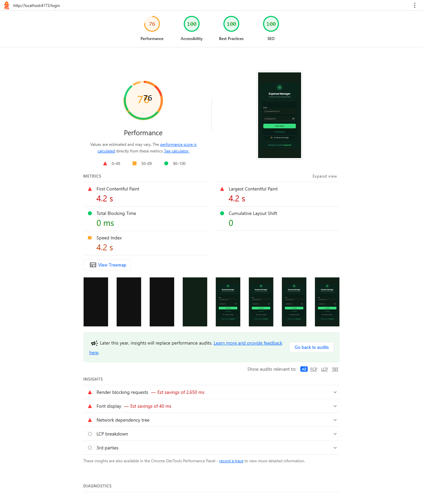

*Figura 8: Lighthouse mobile en `/login`, **después**. Rendimiento 76, SEO 100, LCP 4,2 s.*

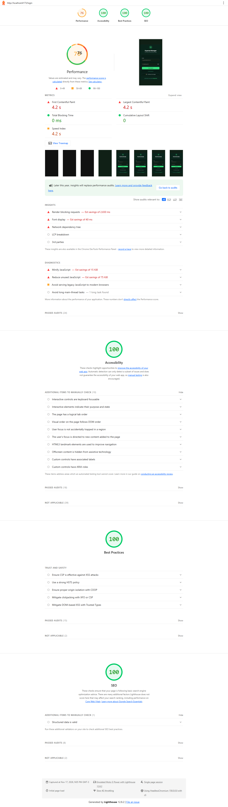

*Figura 9: Lighthouse mobile en `/login`, después. Reporte completo: ya no aparecen la *meta description* ni `robots.txt` entre los problemas.*

### 5.2. Seguridad: actualización de dependencias (H-16 a H-20)

- **API:**
  - `npm audit fix` para las correcciones compatibles;
  - Vitest y `@vitest/coverage-v8` de 2.1 a 5.1;
  - `@faker-js/faker` movido a `devDependencies`;
  - después de cada cambio se corrieron las 252 pruebas unitarias, que siguen pasando.
- **Web:** `npm update follow-redirects axios brace-expansion re2js source-map-js fdir`. `npm audit fix` falla en este proyecto por un error de npm con el alias `vite: npm:rolldown-vite`.

| Métrica | API antes | API después | Web antes | Web después |
| --- | --- | --- | --- | --- |
| Vulnerabilidades totales | 25 (4 críticas) | **7** (0 críticas) | 18 | **14** |
| Vulnerabilidades en **producción** | 7 (1 crítica, 5 altas) | **0** | 12 | **9** |

Las 7 que quedan en la API son solo de desarrollo (la cadena de Vitest y faker). Las 9 de producción de la web son la cadena de Firebase (H-21) y herramientas de *build* que figuran en `dependencies` pero no llegan al navegador (H-22).

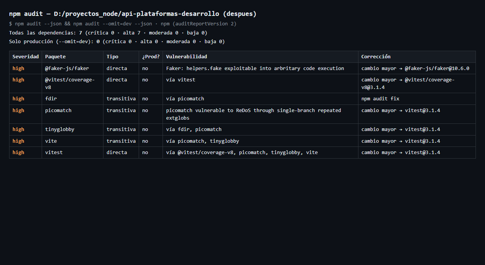

*Figura 10: `npm audit` en la API, **después**. 0 vulnerabilidades en producción (comparar con la Figura 3).*

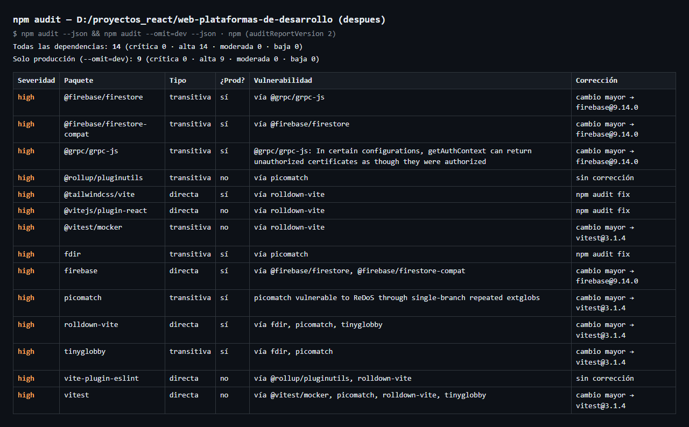

*Figura 11: `npm audit` en la web, **después** (comparar con la Figura 4).*

### 5.3. Calidad del código: código muerto, *hotspot* y errores menores (H-09, H-10, H-12)

- **API:**
  - se eliminó `GastosRepository.settleQuota()`, que nadie usaba;
  - se agregó `app.disable("x-powered-by")` en `index.js`.
- **Web:**
  - se simplificó el ternario con ramas iguales de `StatCards.jsx`;
  - se quitó la asignación redundante de `GastoItem.jsx`;
  - `MontoChart.jsx` pasa la función de formato sin el argumento de más.

| Métrica | Antes | Después |
| --- | --- | --- |
| Problemas SonarJS en la API | 12 | **10** (desaparecen `no-identical-functions` y `x-powered-by`) |
| Problemas SonarJS en la web | 38 | **35** (desaparecen `no-all-duplicated-branches`, `no-redundant-assignments` y `no-extra-arguments`) |

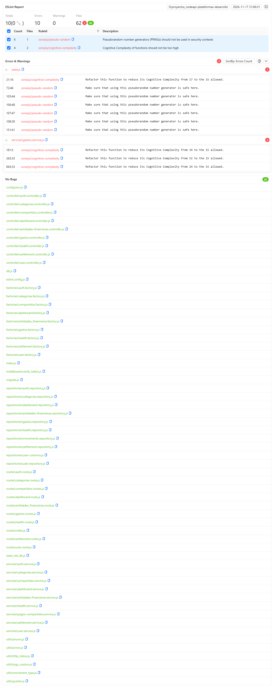

*Figura 12: ESLint + SonarJS sobre la API, **después**. 10 problemas (comparar con la Figura 1).*

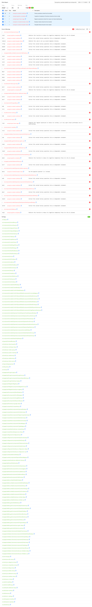

*Figura 13: ESLint + SonarJS sobre la web, **después**. 35 problemas (comparar con la Figura 2).*

## 6. Cierre y aplicación

Lo más revelador fue `npm audit` filtrado a producción: la vulnerabilidad más grave del sistema no estaba en mi código, sino en `jws`, la librería que valida la firma del token de sesión, que es justo la pieza de la que depende que cada usuario vea solo sus datos. También fue inesperado que la fuente de íconos pesara más que todo el JavaScript de la página de login. Hasta la presentación final voy a correr ESLint con SonarJS y `npm audit --omit=dev` en cada *pull request*, mediante la integración continua del TP 3; Lighthouse sobre `/login` y `/register` antes de cada despliegue a producción; y una vez por semana las tres herramientas completas, con una corrida final sobre la versión desplegada antes de la defensa.

## 7. Integración en la tesis

Este documento se incorpora a la memoria de la tesis en la sección de **Verificación y Validación**, después del plan de pruebas unitarias (TP 2) y del plan de mantenimiento (TP 3).
